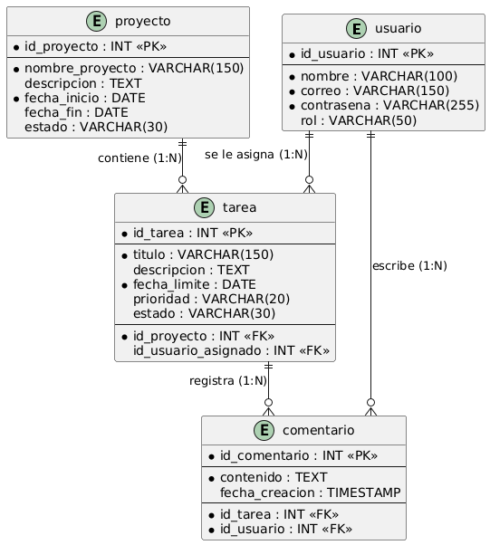
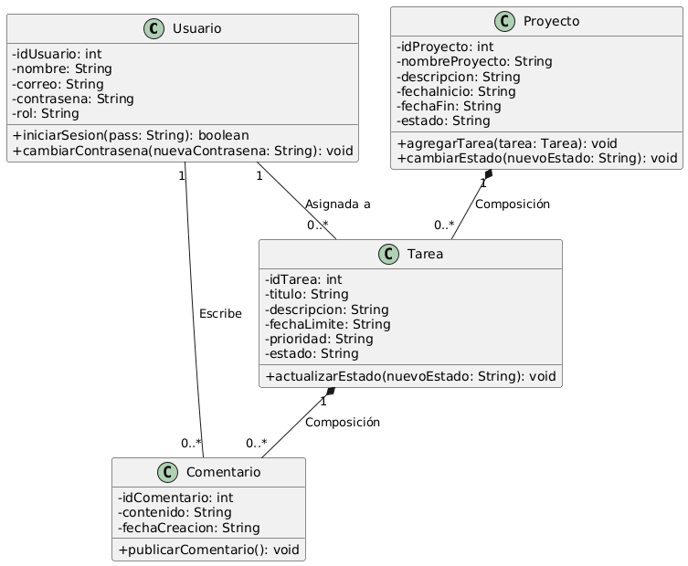
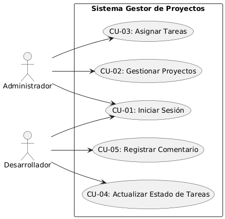

# API para Gestión de Proyectos
# Descripción general
Este Repositorio contiene el codigo fuente y la estructura base correspondiente al proyecto de **Gestion de Proyectos**, desarrollado para la asignatura Programacion Orientada a Objetos de la Carrera Ingenieria en desarrollo de Software. El sistema esta constuido con java utilizando **Maven** como gestor de construccion y dependencias.

## Integrantes del Equipo
* **CO25019** CALL ORTIZ, GABRIEL ANTONIO
* **MG25049** MURILLO GUTIERREZ, KENIA YAMILETH
* **QG24003** QUINTEROS GARCIA, MARCELA DE LOS ANGELES
* **RA23035** RAMOS ALFARO, ROBERTO RAFAEL
* **RM20102** RUZ MARTNEZ,ABNER GABRIEL

# Tecnologias Utilizadas
* **Lenguaje:** Java21
* **Gestor de Construcion:** Maven
* **Control de Versiones** Git & GitHub

### Diagrama Entidad-Relación

## Diagrama de Clases UML

### Diagrama de Casos de Uso

**Especificación de Casos de Uso — Sistema Gestor de Proyectos
Actores**
|**Actor**|**Descripción**|
|---|---|
|Administrador|Gestiona proyectos, asigna tareas, inicia sesión|
|Desarrollador|Inicia sesión,actualiza estados de tareas,registra comentarios|

**CU-01: INICIAR SESION**
**Actores**:Administrador, desarrollador 
**Flujo principal**
1. El actor ingresa usuario
2. El sistema valida las credenciales
3. El sistema redirige al panel según el rol (Administrador o Desarrollador)

**Flujos alternativos**
2a. Credenciales inválidas → el sistema muestra error y permite reintentar
2b. Cuenta bloqueada/inactiva → el sistema deniega el acceso y notifica el motivo
CU-02: Gestionar Proyectos

**Actor principal: Administrador**

**Flujo principal — Crear proyecto**
El administrador selecciona "Nuevo proyecto"
Ingresa nombre, descripción, fecha de inicio/fin
El sistema valida los datos
El sistema crea el proyecto
**Flujos alternativos**
3a. Nombre de proyecto duplicado → el sistema rechaza y solicita otro nombre
4a. Administrador edita un proyecto existente → el sistema actualiza los datos
4b. Administrador elimina un proyecto → el sistema valida que no tenga tareas activas antes de confirmar
**Cobertura CRUD**
Create: alta de proyecto
Read: listado y detalle de proyectos
Update: edición de datos del proyecto
Delete: baja de proyecto (con validación de dependencias)
CU-03: Asignar Tareas

**Actor principal: Administrador**

**Flujo principal**
El administrador selecciona un proyecto
Selecciona un desarrollador
Define la tarea (título, descripción, fecha límite)
El sistema crea la tarea y la asocia al proyecto y al desarrollador
El sistema notifica al desarrollador asignado
**Flujos alternativos**
3a. Desarrollador sin capacidad disponible → el sistema advierte sobrecarga de tareas
4a. Administrador reasigna una tarea existente a otro desarrollador
**Cobertura CRUD**
Create: asignación de nueva tarea
Read: listado de tareas por proyecto/desarrollador
Update: reasignación, edición de fecha límite o descripción
Delete: eliminación de tarea no iniciada
CU-04: Actualizar Estado de Tareas

**Actor principal: Desarrollador**

**Flujo principal**
El desarrollador accede a sus tareas asignadas
Selecciona una tarea
Cambia el estado (pendiente → en progreso → completada)
El sistema guarda el cambio y actualiza el avance del proyecto
**Flujos alternativos**
3a. Desarrollador marca tarea como bloqueada → el sistema solicita motivo del bloqueo
4a. Cambio de estado a "completada" fuera de la fecha límite → el sistema registra el retraso
Cobertura CRUD
Update: único caso de uso sobre la entidad Tarea (el desarrollador no crea ni elimina tareas, solo modifica su estado)
CU-05: Registrar Comentario

**Actor principal: Desarrollador**

**Flujo principal**
El desarrollador selecciona una tarea
Escribe un comentario (avance, duda, bloqueo)
El sistema guarda el comentario con fecha y autor
**Flujos alternativos**
3a. Comentario vacío → el sistema rechaza el envío
3b. Desarrollador edita/elimina un comentario propio dentro de un plazo permitido
**Cobertura CRUD**
Create: nuevo comentario
Read: listado de comentarios por tarea
Update: edición de comentario propio (si aplica)
Delete: eliminación de comentario propio (si aplica)
